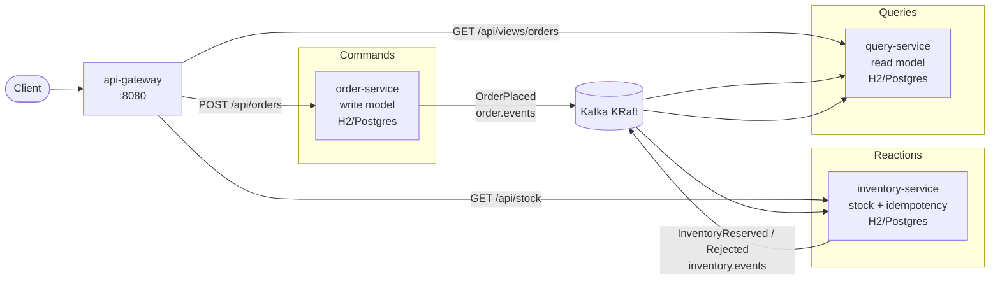

# Enterprise Microservices Gateway

Staff-level demo of an **API Gateway + CQRS** architecture across independently deployable Spring Boot services, coordinated by **Apache Kafka** and a **database-per-service** topology.

**Author:** Douae El Assal · **License:** MIT · **Stack:** Java 21, Spring Boot 3.3, Spring Cloud Gateway, Kafka (KRaft), Maven, Postgres

## Architecture



### CQRS flow

1. **Command:** `POST /api/orders` → order-service persists the write model and publishes `OrderPlaced`.
2. **Reaction:** inventory-service consumes the event, reserves stock (optimistic lock + event-id idempotency), publishes `InventoryReserved` or `InventoryRejected`.
3. **Query:** query-service projects both topics into `order_views` and serves `GET /api/views/orders/{id}`.

Clients never query the command DB for fulfilment status — eventual consistency by design.

## Security (API Gateway)

When `GATEWAY_API_KEY` is set, the gateway requires header `X-API-Key` on all `/api/**` routes and returns **401** if missing or wrong. Actuator `health` / `info` stay open for probes. If the env var is empty, auth is disabled (local unit tests / unsecured local runs).

```bash
cp .env.example .env   # edit GATEWAY_API_KEY — never commit .env
export GATEWAY_API_KEY=dev-local-change-me

curl -s -X POST http://localhost:8080/api/orders \
  -H 'Content-Type: application/json' \
  -H "X-API-Key: ${GATEWAY_API_KEY}" \
  -d '{"customerId":"cust-1","sku":"SKU-WIDGET-001","quantity":2,"unitPrice":19.99}'
```

## Modules

| Module | Role | Port |
|--------|------|------|
| `common` | Shared DTOs + polymorphic domain events | — |
| `api-gateway` | Spring Cloud Gateway + correlation-id + API key filter | 8080 |
| `order-service` | Command side (orders write model → Kafka) | 8081 |
| `inventory-service` | Event consumer / stock reservation | 8082 |
| `query-service` | Read-model projector + query API | 8083 |

## Complexity notes (critical paths)

Documented inline on the hot paths:

| Location | Note |
|----------|------|
| `OrderCommandService#placeOrder` | Persist-then-publish dual-write; production would use transactional outbox |
| `OrderEventPublisher#publish` | Partition key = `orderId` → ordered per aggregate |
| `InventoryReservationService#handleOrderPlaced` | O(1) idempotency PK + optimistic `@Version` stock decrement |
| `StockItem#tryReserve` | Short critical section; conflicts surface as optimistic lock retries |
| `OrderProjectionService` | O(1) upsert projectors; out-of-order tolerant merge |
| `GatewayRoutesConfig` | Path-prefix routing + constant-time correlation header injection |
| `ApiKeyAuthFilter` | Constant-time key compare; auth only when `GATEWAY_API_KEY` is set |

## Quick start (local, H2)

Default `application.yml` uses **H2** file DBs. Unit tests stay on H2 / mocks (no Docker).

```bash
# Kafka required for full E2E:
docker compose up -d kafka

./mvnw -pl order-service -am spring-boot:run
./mvnw -pl inventory-service -am spring-boot:run
./mvnw -pl query-service -am spring-boot:run
GATEWAY_API_KEY=dev-local-change-me ./mvnw -pl api-gateway -am spring-boot:run
```

Place an order through the gateway (with API key when configured):

```bash
curl -s -X POST http://localhost:8080/api/orders \
  -H 'Content-Type: application/json' \
  -H "X-API-Key: ${GATEWAY_API_KEY}" \
  -d '{"customerId":"cust-1","sku":"SKU-WIDGET-001","quantity":2,"unitPrice":19.99}'
```

Poll the read model (after a short lag):

```bash
curl -s http://localhost:8080/api/views/orders/<orderId> \
  -H "X-API-Key: ${GATEWAY_API_KEY}"
```

Seeded SKUs in inventory-service: `SKU-WIDGET-001` (100), `SKU-GADGET-002` (50), `SKU-RARE-003` (2).

## Docker Compose (Postgres profiles)

Persist services use **Postgres** under compose profiles (not H2):

| Profile | What starts |
|---------|-------------|
| *(none)* | Kafka only |
| `postgres` | Kafka + three Postgres instances (database-per-service) |
| `full` | Kafka + Postgres + order / inventory / query / api-gateway |

```bash
cp .env.example .env
export GATEWAY_API_KEY=dev-local-change-me

docker compose --profile full up --build
```

Ingress: `http://localhost:8080` — send `X-API-Key` matching `GATEWAY_API_KEY`.

Spring profile `postgres` (`application-postgres.yml`) is activated in the app containers.

## Integration smoke

Requires Docker. Builds the stack, asserts 401 without a key, places an order with a key, and waits for the query projection:

```bash
./scripts/smoke-integration.sh
```

## Tests (CI / offline)

Unit and sliced Spring MVC tests use **Mockito** — **no Kafka, no Docker** required:

```bash
./mvnw test
```

GitHub Actions runs the same command on every push to `main`.

## License

MIT © Douae El Assal
